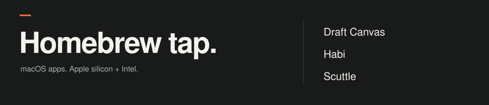

<p align="center">
  
</p>

<p align="center">
  macOS apps, installed with <a href="https://brew.sh">Homebrew</a>.
</p>

### [Draft Canvas](https://acltabontabon.com/draft-canvas/)

Draw software architecture and explain how it works.

```sh
brew install --cask acltabontabon/tap/draft-canvas
```

[Source & releases ↗](https://github.com/acltabontabon/draft-canvas)

### [Habi](https://acltabontabon.com/habi/)

Find agent skills for your repository and preview them before installation.

```sh
brew install --cask acltabontabon/tap/habi
```

[Source & releases ↗](https://github.com/acltabontabon/habi)

### [Scuttle](https://acltabontabon.com/scuttle/)

Organize scattered files and review cleanup with a recoverable drawer.

```sh
brew install --cask acltabontabon/tap/scuttle
```

[Source & releases ↗](https://github.com/acltabontabon/scuttle)

---

<details>
<summary>Installation, compatibility, and updates</summary>

Install [Homebrew](https://brew.sh), then run a command above. Homebrew adds this tap automatically, selects the matching installer, verifies its SHA-256 checksum, and puts the app in **Applications**.

| App | Apple silicon | Intel |
| --- | --- | --- |
| Draft Canvas | macOS 12+ | macOS 12+ |
| Habi | macOS 11+ | macOS 11+ |
| Scuttle | macOS 11+ | macOS 10.15+ |

These are the apps’ minimum versions; [Homebrew has its own requirements](https://docs.brew.sh/Installation). Habi uses a universal installer; the other apps have separate installers for each architecture.

**First launch.** These builds may lack Apple signing or notarization. If macOS blocks an app, try opening it once, then **System Settings → Privacy & Security → Open Anyway** if offered. See [Apple’s instructions](https://support.apple.com/en-us/102445) for your macOS version. Homebrew preserves Gatekeeper checks.

**Updates.** All three apps have their own updater. To update through Homebrew, include `--greedy`:

```sh
brew update
brew upgrade --cask --greedy acltabontabon/tap/draft-canvas
```

Replace `draft-canvas` with `habi` or `scuttle` as needed.

**Uninstall.** Run `brew uninstall --cask acltabontabon/tap/draft-canvas` to remove the app. A normal uninstall preserves your data: Draft Canvas diagrams and recovery data, Habi’s skills and journal, and Scuttle’s drawer, history, and settings.

**Support.** [Report installation problems here](https://github.com/acltabontabon/homebrew-tap/issues/new), with the command, error output, app version, macOS version, and Mac architecture. For app behavior or ideas, use the app’s source repository above.

</details>

<p align="center">
  <a href="https://github.com/acltabontabon/homebrew-tap/actions/workflows/tap-checks.yml">Tap checks</a> ·
  <a href="docs/maintenance.md">Maintenance notes</a>
</p>
